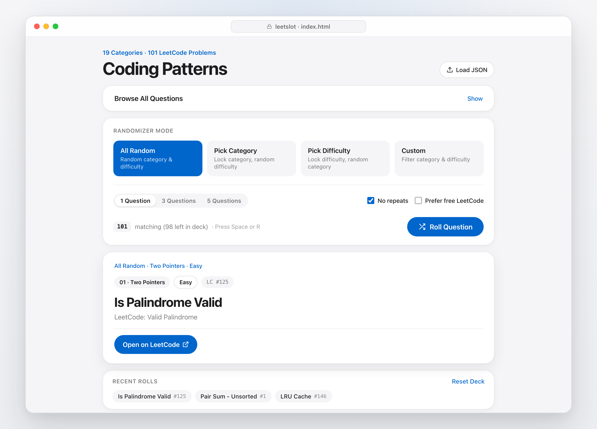
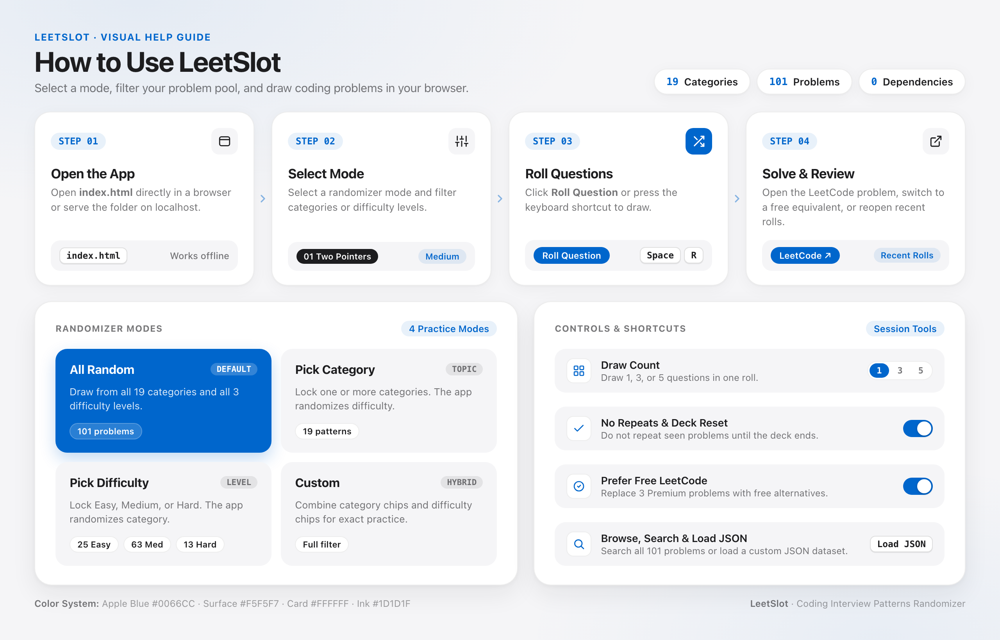

<div align="center">


<h1>LeetSlot</h1>

<p><strong>A browser randomizer for coding interview patterns and LeetCode problems.</strong></p>

<p>
  
  
  
  
  
</p>

<p>
  <a href="#overview">Overview</a> &nbsp;·&nbsp;
  <a href="#visual-guide">Visual Guide</a> &nbsp;·&nbsp;
  <a href="#quick-start">Quick Start</a> &nbsp;·&nbsp;
  <a href="#how-to-use-leetslot">How to Use</a> &nbsp;·&nbsp;
  <a href="#dataset-overview">Dataset</a> &nbsp;·&nbsp;
  <a href="#custom-json-data">Custom JSON</a> &nbsp;·&nbsp;
  <a href="#design-system">Design System</a>
</p>

<br />



</div>

---

## Overview

LeetSlot is a single-file web application for structured algorithm practice.
The application selects random problems from 19 coding interview patterns and 101 LeetCode problems.
LeetSlot runs directly in your web browser with zero external dependencies and zero build steps.

The included dataset contains 25 Easy problems, 63 Medium problems, and 13 Hard problems.
Each problem links directly to LeetCode.

---

## Visual Guide

<div align="center">
  
</div>

---

## Quick Start

### Option 1: Open the File Directly

Use this method for immediate offline use.
The HTML file contains embedded problem data as a fallback.

1. Download or clone this repository to your computer.
2. Open `index.html` in a web browser.

### Option 2: Run a Local Web Server

Use this method when you edit `questions.json` and want the application to load the updated file automatically.

1. Open a terminal in the project folder.
2. Run a local HTTP server:

```bash
python3 -m http.server 8000
```

3. Open `http://localhost:8000` in your web browser.

> **NOTE:** Over HTTP, the application fetches `./questions.json` first. If the fetch fails, the application loads the embedded dataset inside `index.html`.

---

## How to Use LeetSlot

Follow these steps to start a practice session:

1. Select one of the four cards in the **Randomizer Mode** section.
2. Select category chips or difficulty chips if the active mode shows filter blocks.
3. Select **1 Question**, **3 Questions**, or **5 Questions** to set the draw count.
4. Select **No repeats** so the application does not draw the same problem twice in one session.
5. Select **Prefer free LeetCode** to replace the 3 Premium problems with free alternatives.
6. Click **Roll Question** or press `Space` or `R` to draw from the matching pool.
7. Click **Open on LeetCode** to solve the problem.
8. Click any item in **Recent Rolls** to view a previous problem again.
9. Click **Reset Deck** to clear session history and restore all problems to the pool.

### Randomizer Modes

| Mode | Behavior | Active Filters |
| :--- | :--- | :--- |
| **All Random** | Draws from all categories and all difficulty levels. | None |
| **Pick Category** | Locks the selected categories and randomizes the difficulty level. | Category chips |
| **Pick Difficulty** | Locks the selected difficulty levels and randomizes the category. | Difficulty chips |
| **Custom** | Draws only from problems that match both selected categories and difficulty levels. | Category and difficulty chips |

### Controls and Keyboard Shortcuts

| Control | Function |
| :--- | :--- |
| **1 / 3 / 5 Questions** | Sets the number of problems that each roll draws. |
| **No repeats** | Keeps seen problems out of the deck. The application reshuffles the deck automatically when no unseen problems remain. |
| **Prefer free LeetCode** | Replaces the 3 Premium problems with free LeetCode alternatives. |
| `Space` or `R` | Draws a new roll when the cursor is not in a text field. |
| **Browse All Questions** | Opens a searchable list of all 101 problems by category. |
| **Load JSON** | Loads a custom JSON file from your computer without a page reload. |
| **Reset Deck** | Clears the seen list and removes items from **Recent Rolls**. |

---

## Dataset Overview

The dataset maps 101 coding interview questions to LeetCode across 19 pattern categories.

| Difficulty | Count | Share |
| :--- | :---: | :---: |
| **Easy** | 25 | 24.8% |
| **Medium** | 63 | 62.4% |
| **Hard** | 13 | 12.9% |
| **Total** | **101** | **100%** |

> **NOTE:** Three problems in the dataset require LeetCode Premium (`LC #1891`, `LC #253`, and `LC #314`). Each Premium entry includes a free equivalent (`LC #875`, `LC #2406`, and `LC #987`).

<details>
<summary><strong>View All 19 Pattern Categories</strong></summary>

| ID | Category | Problems |
| :---: | :--- | :---: |
| `01` | Two Pointers | 6 |
| `02` | Hash Maps And Sets | 5 |
| `03` | Linked Lists | 6 |
| `04` | Fast And Slow Pointers | 3 |
| `05` | Sliding Windows | 3 |
| `06` | Binary Search | 8 |
| `07` | Stacks | 6 |
| `08` | Heaps | 4 |
| `09` | Intervals | 3 |
| `10` | Prefix Sums | 3 |
| `11` | Trees | 12 |
| `12` | Tries | 3 |
| `13` | Graphs | 10 |
| `14` | Backtracking | 5 |
| `15` | Dynamic Programming | 9 |
| `16` | Greedy | 3 |
| `17` | Sort And Search | 4 |
| `18` | Bit Manipulation | 3 |
| `19` | Math And Geometry | 5 |

</details>

---

## Custom JSON Data

You can load your own problem list at any time.

1. Make a `.json` file that contains a top-level `categories` array.
2. Click **Load JSON** in the top-right corner of the application.
3. Select your `.json` file in the file dialog.

```json
{
  "title": "Custom Problem Set",
  "categories": [
    {
      "id": "01",
      "slug": "two-pointers",
      "name": "Two Pointers",
      "questions": [
        {
          "id": "01-01",
          "title": "Pair Sum - Sorted",
          "leetcodeNumber": 167,
          "leetcodeTitle": "Two Sum II - Input Array Is Sorted",
          "url": "https://leetcode.com/problems/two-sum-ii-input-array-is-sorted/",
          "difficulty": "Medium",
          "matchType": "exact",
          "premium": false
        }
      ]
    }
  ]
}
```

Add an optional `freeAlternative` object (`leetcodeNumber`, `leetcodeTitle`, `url`, `difficulty`) to any Premium question to support **Prefer free LeetCode**.

---

## Design System

LeetSlot follows Apple Human Interface Guidelines for color, typography, and icon geometry.

| Token | Hex Value | Role |
| :--- | :--- | :--- |
| `--blue` | `#0066CC` | Primary actions, active mode, and icon slot body |
| `--blue-hover` | `#0055B3` | Hover state for primary buttons and icon outline |
| `--white` | `#FFFFFF` | Card surfaces and icon reel window |
| `--gray` | `#F5F5F7` | Page canvas and secondary chips |
| `--black` | `#1D1D1F` | Primary text, Hard badges, and icon code symbols |

### Icon Assets

| File | Dimensions | Purpose |
| :--- | :--- | :--- |
| `assets/icon.svg` | Vector (`1024×1024`) | Browser favicon and scalable app icon |
| `assets/apple-touch-icon.png` | `180×180` RGB | iOS and iPadOS Home Screen icon |

---

## Project Structure

```text
leetslot/
├── assets/
│   ├── apple-touch-icon.png   # 180x180 iOS Home Screen icon
│   ├── help-guide.png         # Apple-style visual help guide
│   ├── icon.svg               # Scalable vector app icon and favicon
│   └── preview.png            # macOS browser preview of the app
├── coding-interview-patterns.md  # Markdown checklist for all 19 categories
├── index.html                 # Standalone web application
├── LICENSE                    # MIT License
├── questions.json             # 19 categories and 101 LeetCode problems
└── README.md                  # Project documentation (ASD-STE100)
```

---

## License

This project uses the [MIT License](./LICENSE).
All problem links open directly on [LeetCode](https://leetcode.com/).
